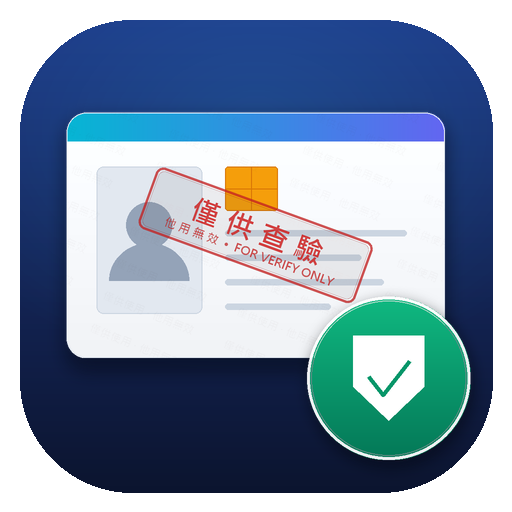
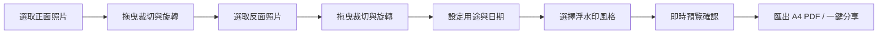

<p align="center">
  
</p>

<h1 align="center">證件浮水印 (ID Card Watermark)</h1>

<p align="center">
  <b>專為台灣身分證及各類證件設計的「本機防偽浮水印」與「A4 影本 PDF」產生工具。</b><br/>
  🛡️ 100% 離線處理 ｜ 🚫 零網路權限 ｜ 🔒 像素級防偽 ｜ 📐 1:1 真實尺寸排版
</p>

<p align="center">
  
  
  
  
  
</p>

---

## 💡 為什麼需要「證件浮水印」？

在台灣日常生活中，不論是**租屋簽約、銀行開戶、門號申辦、求職報到或補助申請**，經常需要提供身分證正反面影本。

然而，直接傳送未加防護的證件照片，極容易面臨被盜用、冒名申貸或二次轉傳的巨大個資風險。線上免費浮水印工具又有將身分證照片上傳至他人伺服器的安全疑慮。

**「證件浮水印」旨在提供最安全、最便捷的解決方案：**
- **零連網**：應用程式完全不宣告網路權限，所有影像皆在手機晶片本機端完成處理。
- **防止抹除**：浮水印直接繪入影像像素，並非 PDF 的分離文字圖層，無法用 PDF 編輯器簡單移除。
- **1:1 原尺寸列印**：自動排版於單頁 A4，正反面尺寸符合標準卡片大小（85.6 × 54 mm），印出直接可用。

---

## ✨ 核心特色

- 🛡️ **隱私至上（Privacy-First）**
  - AndroidManifest 完全沒有宣告 `INTERNET` 網路權限，照片絕不離機、不上傳任何雲端。
  - 使用 Android 原生照片選擇器（`PickVisualMedia`），毋需向使用者索取「存取整個相簿」的高風險權限。
- 📐 **智慧證件裁切與旋轉**
  - 挑選照片後立即進入裁切畫面，可自由拖曳四個角貼齊證件邊界。
  - 預設鎖定標準證件長寬比例（`85.6 : 54`），亦可切換為自由比例。
  - 支援 `90° 順時針旋轉`，橫拍、直拍皆能輕鬆擺正。
  - 裁切影像全程保留在記憶體中交接，不留暫存圖檔於磁碟。
- 🔒 **像素級防偽烙印（Burn-in Watermark）**
  - 浮水印直接畫進 Bitmap 像素陣列中，確保匯出的 PDF 檔無獨立浮水印文字層可供編輯器單獨選取刪除。
  - 預設產生字樣：「`僅供「指定用途」使用，他用無效 YYYY/MM/DD`」。
- 🎨 **雙浮水印排版模式**
  - **斜向重複平鋪**：文字呈 -30° 傾斜均勻覆蓋全證件，防護死角最少。
  - **單行大字橫跨中央**：帶有醒目白色外描邊與半透明紅字，橫跨證件中央，不擋重要文字又能明確宣示用途。
- 🖨️ **標準單頁 A4 PDF 匯出**
  - 排版以 300 dpi 高解析度計算（2480 × 3508 像素），細緻文字與身分證防偽細節依然清晰。
  - 正面在上、反面在下，並加上淺灰外框線，方便直接發送或送交印表機列印。
- 📂 **支援 MediaStore Downloads 目錄**
  - 產出檔案存放於手機的「下載（Downloads）」資料夾，符合 Android 10+ Scoped Storage 規範，可直接點擊開啟或透過 LINE、Email、雲端硬碟分享。

---

## 📱 使用流程



1. **選擇並裁切正面 / 反面**：從相簿選取照片後，調整四角貼齊證件邊界，若角度不對可按「旋轉 90°」，確認後按「確定」。
2. **填寫用途與確認日期**：輸入如「租屋申請」、「○○銀行開戶」，日期預設為當日，點擊可透過日曆彈窗調整。
3. **選擇浮水印樣式**：依喜好挑選「斜向重複平鋪」或「單行大字橫跨中央」。
4. **預覽與匯出**：點擊「預覽」可在畫面下方查看合成效果；點擊「匯出 PDF」即自動儲存至「下載」資料夾，完成後可直接「開啟」或「分享」。

---

## 🏗️ 專案結構

```
IdWatermark/
├── app/
│   ├── src/main/
│   │   ├── java/tw/example/idwatermark/
│   │   │   ├── MainActivity.kt        # 主畫面邏輯、選圖喚起、日期設定、PDF 匯出與分享
│   │   │   ├── CropActivity.kt        # 裁切畫面 Activity
│   │   │   ├── CropImageView.kt       # 自訂裁切 View（四角拖曳、比例鎖定、九宮格輔助線）
│   │   │   ├── CropHandoff.kt         # 影像記憶體安全交接物件
│   │   │   └── WatermarkRenderer.kt   # A4 1:1 排版計算、Canvas 浮水印渲染、PDFDocument 輸出
│   │   ├── res/
│   │   │   ├── layout/                # UI 佈局檔（activity_main.xml、activity_crop.xml）
│   │   │   ├── mipmap-*/              # 完整適配的自適應（Adaptive）與傳統 App 圖示
│   │   │   └── values/                # 字串資源、色彩與 Material 3 主題
│   │   └── AndroidManifest.xml        # 清單檔（無 INTERNET 宣告）
│   └── build.gradle.kts               # 模組建構配置（AGP 8.5+、Kotlin 1.9+）
├── assets/                            # README 與專案公開資源（包含 App 圖示）
├── gradle/                            # Gradle Wrapper 相關配置（Gradle 8.12）
├── build.gradle.kts                   # 頂層建構配置
└── README.md                          # 專案繁體中文說明文件
```

---

## 🛠️ 開發與編譯

### 環境需求
- **Android Studio**：建議 Android Studio Jellyfish / Koala / Ladybug 或更高版本。
- **JDK**：Java 17（建議 OpenJDK 17 或 Microsoft OpenJDK 17）。
- **Android SDK**：Compile SDK 34 / Min SDK 29。

### 建構步驟

1. **複製專案庫**：
   ```bash
   git clone https://github.com/kochunchung/IdWatermark.git
   cd IdWatermark
   ```

2. **使用 Android Studio 開啟**：
   - 開啟 Android Studio，選擇 `Open` 並選取本目錄。
   - 等待 Gradle 同步完成。

3. **透過命令列編譯 APK**：
   - **編譯 Release 版（已包含預簽署，可直接安裝）**：
     ```bash
     ./gradlew assembleRelease
     ```
     產出位置：`app/build/outputs/apk/release/app-release.apk`
   - **編譯 Debug 版**：
     ```bash
     ./gradlew assembleDebug
     ```
     產出位置：`app/build/outputs/apk/debug/app-debug.apk`

---

## 📄 開源授權

本專案採用 [MIT License](LICENSE) 授權開放原始碼。歡迎社群自由分叉、改良或提出建議！
